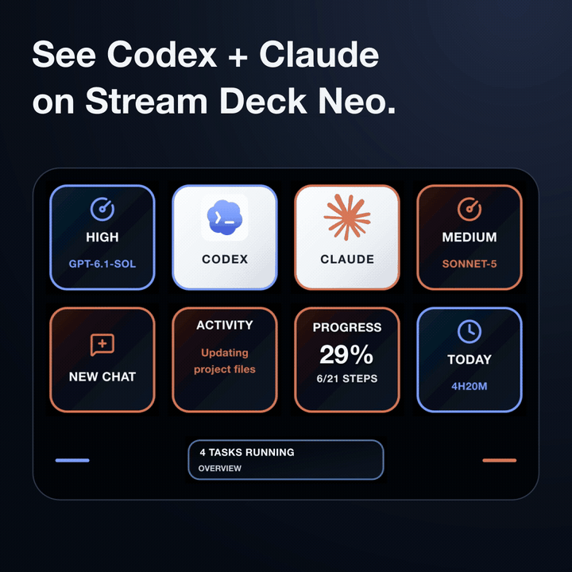

# Agent Pulse — Codex and Claude on Stream Deck Neo

**See your AI coding tasks at a glance, right on your desk.**

Follow Codex and Claude Code task states, recorded plan progress, and observed
working time on your Mac and Stream Deck Neo.

*Interface walkthrough using the production Neo renderer and synthetic demo
data. This is not physical-device footage. [Watch the 20-second video](docs/media/agent-pulse-ui-demo-v2.mp4).*

**[Get Agent Pulse on the Mac App Store](https://apps.apple.com/app/id6815483068)**
· [Setup guide](#how-to-use-it) · [Requirements](#features-and-requirements)
· [Source license](LICENSE)

**Before installing:** Apple Silicon Mac · macOS 13+ · USB-connected **Stream Deck
Neo only** · Codex and/or Claude Code installed separately.
Quit the Elgato Stream Deck app while Agent Pulse controls Neo.
Execution and approvals stay in the original agent apps.

The official ready-to-install edition is available on the Mac App Store.
US price checked October 16, 2026: **$2.99**; local pricing and availability vary.
This repository provides source under the [source-available license](LICENSE),
with no prebuilt app downloads.

## What you can see

- **Task states:** running, completed, and paused tasks on dedicated agent pages.
- **Recorded progress:** structured plan steps when available, plus observed working time.
- **Agent context:** model and reasoning effort when present in local records.

## More interface previews

These still previews also use **synthetic demo data**.

## How to use it

### 1. Connect your Neo

Install Agent Pulse from the App Store and connect a Stream Deck **Neo** by USB.
Quit the Elgato Stream Deck app before enabling Agent Pulse's device control.
Have Codex and/or Claude installed and run a task so their local logs exist.

### 2. Enable the agents

Open Agent Pulse's **Settings → Agent Integrations** and enable the agents you
use. In the App Store edition, click **Choose log folder** for each agent:

| Agent | Folder to choose |
|---|---|
| Codex | `~/.codex` |
| Claude | `~/.claude/projects` |
| Claude Desktop model data (optional) | `~/Library/Application Support/Claude/claude-code-sessions` |

Press **Command + Shift + G** in the folder picker to enter a hidden folder's
path. The optional Claude Desktop grant adds model and reasoning information.
The default self-built edition discovers local agent folders automatically.

### 3. Turn on device control

In **Stream Deck & Startup**, select your Neo, enable **Control Neo**, and click
**Save settings**. Check **Setup Status** for missing access or a busy device.
**Launch at login** is optional and off by default; enable it and save if wanted.

### 4. Follow your work

Start and approve tasks in Codex or Claude. Use the agent entries on Neo to
browse task pages; lit touch controls indicate that more content is reachable
in that direction. The App Store edition observes tasks; execution and approvals
stay in the original agent apps.

On your Mac, use **Working Time** to choose an agent and a day, week, month, or
year. Closing the settings window keeps monitoring active. Choose **Quit** from
the menu bar to stop the app.

### If something is missing

- **Neo is busy:** quit the Elgato Stream Deck app, reconnect Neo, and check
  **Control Neo** and the selected device.
- **No tasks:** confirm the agent is enabled, has local logs, and (for the store
  edition) has the correct folder grant. New activity may be needed to appear.
- **Remove access:** use **Revoke access** beside an agent folder, or
  **Remove integrations** in Maintenance. Original agent conversations are not deleted.

## Features and requirements

- Monitor Codex and Claude locally, with distinct colors for each agent.
- Browse task pages on Stream Deck Neo and see when work completes.
- See the actual model and reasoning effort when the agent provides them.
- Track observed working time and browse calendar history on your Mac.
- Configure monitoring, device ownership, menu bar behavior, and login startup.

Working time is observed activity, not token usage, billing, or model compute
time. Progress percentages describe structured plan steps when available.

You need an **Apple Silicon Mac with macOS 13 or later**, a USB-connected
**Stream Deck Neo**, and Codex and/or Claude with local task records. Other
Stream Deck models, Intel Macs, Windows, iOS, and iPadOS are not supported.
Agent accounts, service access, and hardware are obtained separately.

The app interface and project documentation are available in **English only**.
Task titles and activity text are shown in the language supplied by your agents.

## Dependencies and third-party licenses

Node.js, npm, and Xcode Command Line Tools are build requirements; App Store
users do not need to install them. The main software dependencies are:

| Dependency | Purpose | License summary |
|---|---|---|
| Electron | macOS application runtime | MIT; bundled Chromium has additional notices |
| Electron Forge | Packaging the local app and DMG | MIT |
| TypeScript / Vite | Type checking and bundling | Apache-2.0 / MIT |
| `@elgato-stream-deck/node` | Stream Deck USB communication | MIT |
| Sharp / libvips | Image rendering and processing | Apache-2.0 / LGPL-3.0-or-later |
| `lucide-static` | UI icons | ISC; see included notices |
| `ws` / Acorn | Local WebSocket IPC / parsing | MIT |
| Lobe Icons SVG assets | Agent brand icons | MIT; third-party trademark rights remain separate |

Exact versions and transitive dependencies are recorded in [package-lock.json](package-lock.json)
and [the app lockfile](packages/app/package-lock.json). See the
[root manifest](package.json) and [app manifest](packages/app/package.json) for
build commands and direct dependencies. Retain [THIRD_PARTY_NOTICES.md](THIRD_PARTY_NOTICES.md)
and the [asset attribution](ASSET_NOTICES.md); the project's source-available
license does not replace third-party licenses. After installing the app-local
dependencies, `npm run notices` regenerates the bundled dependency notices.

## Privacy

Agent Pulse runs locally, with no developer-operated account system, telemetry,
advertising, or cloud synchronization. It does not upload prompts, conversations,
source code, or approval content to the developer. Agent services operate under
their own terms. Read the [privacy policy](PRIVACY.md) for data storage,
permissions, and removal instructions.

## License and contributions

Agent Pulse is **source-available** under the
[Agent Pulse Source-Available License 1.0](LICENSE), not an OSI-approved
open-source license.

- Inspect, modify, build, and use it personally or for internal business work,
  including paid work, without buying the official app.
- Share source forks and patches without charging for source access; retain
  the license and notices and mark changes.
- Share internal builds within the same legal entity under the license.
- Do not distribute prebuilt copies to external users, even for free; resell
  or rebrand the app for sale; upload it to an app store; or supply it as a
  product or hosted service to external customers.
- Third-party components keep their own licenses and redistribution rights.
  See [third-party notices](THIRD_PARTY_NOTICES.md).

No third-party resale, white-label, or commercial redistribution licenses are
offered. This section is a summary; the full license controls the permissions.

Use this repository's GitHub Issues for source-build bug reports and suggestions.
The source-available project does not offer email customer support or promise
a response time. For an official App Store purchase, use the support link on
the App Store listing. Read [CONTRIBUTING.md](CONTRIBUTING.md) before submitting
code or assets. Never share private conversations, credentials, personal contact
details, or unredacted diagnostics in a public issue.

Agent Pulse is developed by Doonutsaur Games LLC and is not affiliated with or
endorsed by OpenAI, Anthropic, or Elgato. Their names and marks belong to their
respective owners.
