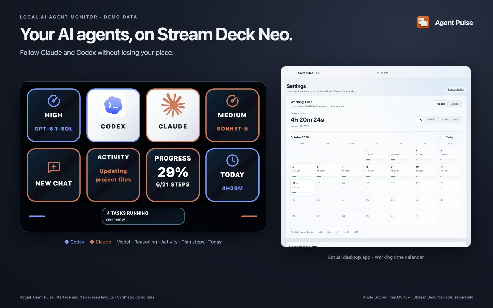
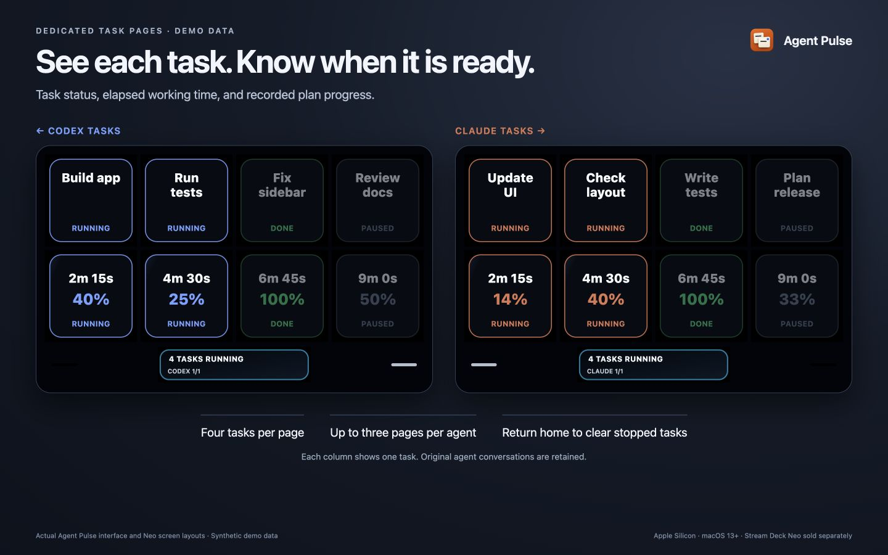
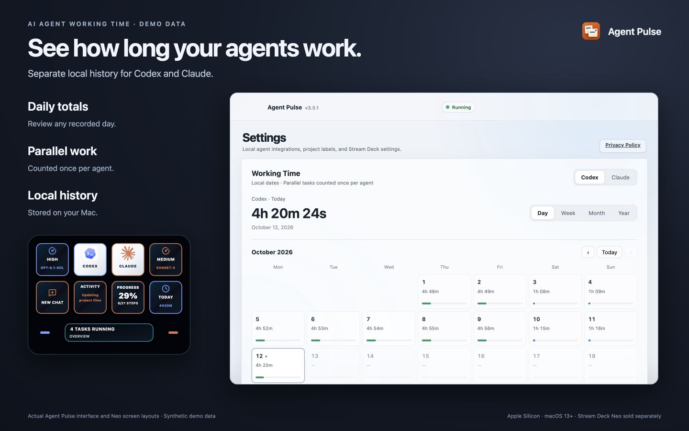

[**Download Agent Pulse on the Mac App Store**](https://apps.apple.com/app/id6815483068)

# Agent Pulse — AI agent monitor for Stream Deck Neo

Monitor Codex and Claude task activity, completion, and observed working time
on your Stream Deck Neo, with a calendar on your Mac.

**Supported device: Stream Deck Neo only.** Other Stream Deck models are not supported.

[中文说明](README.zh-CN.md)

The App Store provides the official ready-to-install edition and its updates.
Availability depends on release status and your storefront. Purchasing the app
supports continued development. This repository provides source code only;
there are no prebuilt downloads here.

## See it in action

These previews show the Agent Pulse interface and Stream Deck Neo screen layouts
using **synthetic demo data**.

**Neo overview.** Follow Codex and Claude activity, model information, plan
progress, and today's working time at a glance.



**Agent task pages.** Each column represents a task, with its status, elapsed
working time, and recorded plan progress. Blue identifies Codex; orange identifies Claude.



**Working time.** Review each agent's daily totals and local history on your Mac,
with today's total also visible on Neo.



## How to use it

### 1. Connect your Neo

Install Agent Pulse from the App Store and connect a Stream Deck **Neo** by USB.
Quit the Elgato Stream Deck app before enabling Agent Pulse's device control.
Have Codex and/or Claude installed and run a task so their local logs exist.

### 2. Enable the agents

Open Agent Pulse's **Settings → Agent Integrations** and enable the agents you
use. In the App Store edition, click **Choose log folder** for each agent:

| Agent | Folder to choose |
|---|---|
| Codex | `~/.codex` |
| Claude | `~/.claude/projects` |
| Claude Desktop model data (optional) | `~/Library/Application Support/Claude/claude-code-sessions` |

Press **Command + Shift + G** in the folder picker to enter a hidden folder's
path. The optional Claude Desktop grant adds model and reasoning information.
The default self-built edition discovers local agent folders automatically.

### 3. Turn on device control

In **Stream Deck & Startup**, select your Neo, enable **Control Neo**, and click
**Save settings**. Check **Setup Status** for missing access or a busy device.
**Launch at login** is optional and off by default; enable it and save if wanted.

### 4. Follow your work

Start and approve tasks in Codex or Claude. Use the agent entries on Neo to
browse task pages; lit touch controls indicate that more content is reachable
in that direction. The App Store edition observes tasks; execution and approvals
stay in the original agent apps.

On your Mac, use **Working Time** to choose an agent and a day, week, month, or
year. Closing the settings window keeps monitoring active. Choose **Quit** from
the menu bar to stop the app.

### If something is missing

- **Neo is busy:** quit the Elgato Stream Deck app, reconnect Neo, and check
  **Control Neo** and the selected device.
- **No tasks:** confirm the agent is enabled, has local logs, and (for the store
  edition) has the correct folder grant. New activity may be needed to appear.
- **Remove access:** use **Revoke access** beside an agent folder, or
  **Remove integrations** in Maintenance. Original agent conversations are not deleted.

## Features and requirements

- Monitor Codex and Claude locally, with distinct colors for each agent.
- Browse task pages on Stream Deck Neo and see when work completes.
- See the actual model and reasoning effort when the agent provides them.
- Track observed working time and browse calendar history on your Mac.
- Configure monitoring, device ownership, menu bar behavior, and login startup.

Working time is observed activity, not token usage, billing, or model compute
time. Progress percentages describe structured plan steps when available.

You need an **Apple Silicon Mac with macOS 13 or later**, a USB-connected
**Stream Deck Neo**, and Codex and/or Claude with local task records. Other
Stream Deck models, Intel Macs, Windows, iOS, and iPadOS are not supported.
Agent accounts, service access, and hardware are obtained separately.

## Build from source

Install Node.js 24 or later (including Node-API headers), npm, and Xcode
Command Line Tools (`xcode-select --install`). From the repository root:

```sh
npm ci
npm run build
npm test
```

To open the development app after building:

```sh
npm run app:dev
```

To create a local independent app and DMG for your own use:

```sh
npm run prepare:app-deps
npm run package:mac
```

The app bundle is under `packages/app/out/Agent Pulse-darwin-arm64/`; the DMG
is under `packages/app/out/make/`. These are local build outputs, not public
release artifacts. The normal local build requires neither the maintainer's
signing credentials nor an Apple Developer membership. It is not Developer ID
signed or notarized. macOS may require explicit approval to open it; keep
macOS security protections enabled.

Some integration checks require local IPC permissions; device checks need a
connected Neo. Building or running tests does not install the app or verify
your physical device. Development runs can use existing Agent Pulse settings
and take control of the connected Neo.

## Source build and App Store edition

The default source build uses the independent configuration. The store edition
uses a separate MAS / App Sandbox configuration; the editions are not identical.

| Capability | Default source build | App Store edition |
|---|---|---|
| Neo task display and working time history | Yes | Yes |
| Agent log access | Local integration settings | User-selected folders with revocable access |
| Managed Codex and Claude hooks | Available | Not included |
| Project verification and cross-app keyboard actions | Available with required permissions | Not included |
| Task execution and approvals | Depends on integration | In the original agent apps |
| Updates | Rebuild from source | Through the App Store |

The MAS packaging script requires your own Apple signing identity, provisioning
profile, and numeric build number. The maintainer's credentials are not part
of the source build. This license does not authorize uploading your build to
an app store or distributing it to external users.

## Dependencies and third-party licenses

Node.js, npm, and Xcode Command Line Tools are build requirements; App Store
users do not need to install them. The main software dependencies are:

| Dependency | Purpose | License summary |
|---|---|---|
| Electron | macOS application runtime | MIT; bundled Chromium has additional notices |
| Electron Forge | Packaging the local app and DMG | MIT |
| TypeScript / Vite | Type checking and bundling | Apache-2.0 / MIT |
| `@elgato-stream-deck/node` | Stream Deck USB communication | MIT |
| Sharp / libvips | Image rendering and processing | Apache-2.0 / LGPL-3.0-or-later |
| `lucide-static` | UI icons | ISC; see included notices |
| `ws` / Acorn | Local WebSocket IPC / parsing | MIT |
| Lobe Icons SVG assets | Agent brand icons | MIT; third-party trademark rights remain separate |

Exact versions and transitive dependencies are recorded in [package-lock.json](package-lock.json)
and [the app lockfile](packages/app/package-lock.json). See the
[root manifest](package.json) and [app manifest](packages/app/package.json) for
build commands and direct dependencies. Retain [THIRD_PARTY_NOTICES.md](THIRD_PARTY_NOTICES.md)
and the [asset attribution](ASSET_NOTICES.md); the project's source-available
license does not replace third-party licenses. After installing the app-local
dependencies, `npm run notices` regenerates the bundled dependency notices.

## Privacy

Agent Pulse runs locally, with no developer-operated account system, telemetry,
advertising, or cloud synchronization. It does not upload prompts, conversations,
source code, or approval content to the developer. Agent services operate under
their own terms. Read the [privacy policy](PRIVACY.md) for data storage,
permissions, and removal instructions.

## License and contributions

Agent Pulse is **source-available** under the
[Agent Pulse Source-Available License 1.0](LICENSE), not an OSI-approved
open-source license.

- Inspect, modify, build, and use it personally or for internal business work,
  including paid work, without buying the official app.
- Share source forks and patches without charging for source access; retain
  the license and notices and mark changes.
- Share internal builds within the same legal entity under the license.
- Do not distribute prebuilt copies to external users, even for free; resell
  or rebrand the app for sale; upload it to an app store; or supply it as a
  product or hosted service to external customers.
- Third-party components keep their own licenses and redistribution rights.
  See [third-party notices](THIRD_PARTY_NOTICES.md).

No third-party resale, white-label, or commercial redistribution licenses are
offered. This section is a summary; the full license controls the permissions.

Use this repository's GitHub Issues for source-build bug reports and suggestions.
The source-available project does not offer email customer support or promise
a response time. For an official App Store purchase, use the support link on
the App Store listing. Read [CONTRIBUTING.md](CONTRIBUTING.md) before submitting
code or assets. Never share private conversations, credentials, personal contact
details, or unredacted diagnostics in a public issue.

Agent Pulse is developed by Doonutsaur Games LLC and is not affiliated with or
endorsed by OpenAI, Anthropic, or Elgato. Their names and marks belong to their
respective owners.
